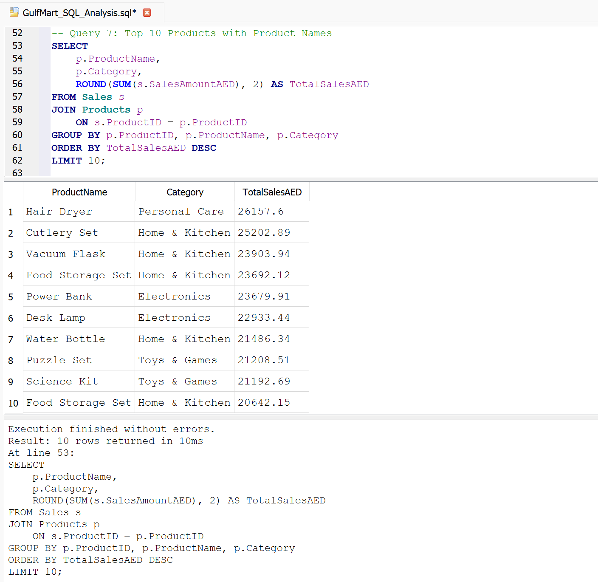
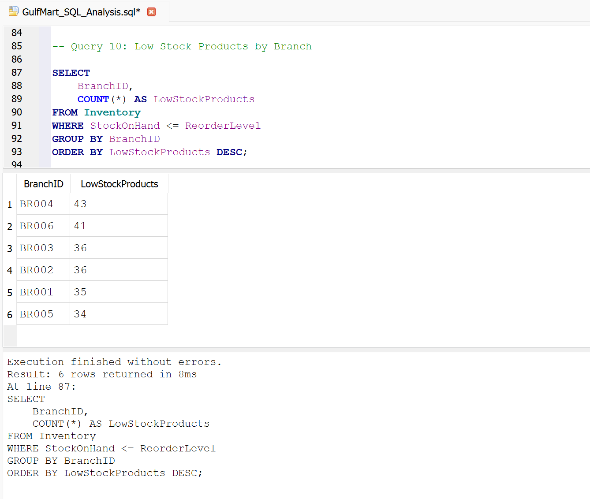

# GulfMart Retail – Operations & Inventory Optimization Dashboard

A Power BI and SQL portfolio project focused on retail sales performance, inventory optimization, stock replenishment risks, and supplier performance.

---

## 1. Project Overview

This project analyses retail operations using Microsoft Power BI, SQL, and a simulated retail dataset.

The objective is to transform operational data into meaningful business insights that help management monitor sales, identify inventory risks, evaluate supplier performance, and make informed operational decisions.

This is a self-created portfolio project using fictional business data.

## 2. Business Objectives

- Monitor overall retail sales and operational performance.
- Identify products and branches with low-stock and replenishment risks.
- Analyse inventory levels and stock distribution.
- Evaluate supplier performance and purchasing activity.
- Identify operational improvement opportunities.
- Present actionable insights through interactive dashboards.

## 3. Tools & Technologies

| Tool | Purpose |
|---|---|
| Microsoft Power BI Desktop | Dashboard development and visualisation |
| Power Query | Data preparation and transformation |
| DAX | Business measures and calculations |
| Microsoft Excel | Dataset preparation |
| SQLite | Database management and SQL analysis |
| DB Browser for SQLite | SQL query execution and analysis |

## 4. Dataset Information

The project uses a simulated retail dataset containing:

- 80 products
- 6 branches
- 2,500 sales records
- 300 purchase-order lines
- Currency: AED
- Reporting period: 1 January – 30 September 2026
- Inventory snapshot: 30 September 2026

The dataset represents a fictional retail business operating across multiple branches.

## 5. Dashboard Preview

The Power BI report contains four main pages.

### 5.1 Sales & Inventory Overview

Provides an overview of sales performance, units sold, inventory value, and stock replenishment risks.

### 5.2 Supplier Performance

Evaluates supplier purchasing activity and performance to support better procurement decisions.

### 5.3 Business Insights & Recommendations

Highlights key findings from sales, inventory, branch-level risks, and supplier analysis.

### 5.4 Management Summary

Presents management priorities, key operational findings, and recommended actions.

## 6. Interactive Dashboard Views

The report includes interactive slicers for reporting period, branch, and product category.

These views demonstrate how users can explore the dashboard using different filter selections.

### Interactive View 1

### Interactive View 2

## 7. Dashboard Highlights

- Retail sales and inventory performance monitoring.
- Branch-level inventory risk analysis.
- Product category and stock distribution analysis.
- Supplier performance evaluation.
- Interactive filtering using dashboard slicers.
- Business insights and management recommendations.

## 8. SQL Analysis

SQLite was used to analyse retail sales, products, branches, inventory, and supplier performance.

A total of 14 SQL queries were developed to explore the dataset and identify relevant business insights.

### Query 7 – Top 10 Products

Identifies the top-performing products based on total sales value.

### Query 10 – Low Stock Products by Branch

Identifies branches with products at or below their reorder levels.

### Query 13 – Supplier Performance Analysis

Evaluates supplier purchasing activity and total purchase order value.

**Screenshot 1**

**Screenshot 2**

## 9. Business Insights & Recommendations

The analysis focuses on:

- Identifying products that require stock replenishment.
- Highlighting branches with inventory risks.
- Evaluating supplier performance.
- Improving inventory planning and stock availability.
- Supporting better purchasing and operational decisions.

### Recommendations

- Prioritise replenishment in branches with higher inventory risk.
- Investigate supplier delays and improve delivery reliability.
- Monitor category-level stock availability.
- Use monthly sales trends to support purchasing and inventory planning.

## 10. Key Learnings

- Preparing and transforming data using Power Query.
- Developing business measures using DAX.
- Designing interactive Power BI dashboards.
- Working with relational data using SQLite.
- Writing SQL queries for business analysis.
- Translating analytical findings into business recommendations.

## 11. Project Files

| File | Description |
|---|---|
| Power BI PBIX | Interactive dashboard report |
| Project Documentation | Detailed project documentation |
| SQL Analysis File | SQL queries used for analysis |
| Dashboard PNG Screenshots | Dashboard pages and interactive views |
| SQL Query Screenshots | Selected SQL query results |

## 12. Data Coverage & Limitations

This project uses fictional, simulated data created for portfolio and learning purposes.

The reporting period covers 1 January to 30 September 2026, with inventory represented by a snapshot dated 30 September 2026.

Sales and purchase-order transactions are simulated. The findings are illustrative and do not represent the performance of a real retail business.

---

**Project Type:** Power BI & SQL Portfolio Project

**Focus:** Retail Analytics | Inventory Optimization | Sales Analysis | Supplier Performance

**Tools:** Power BI | SQL | SQLite | Excel | Power Query | DAX
